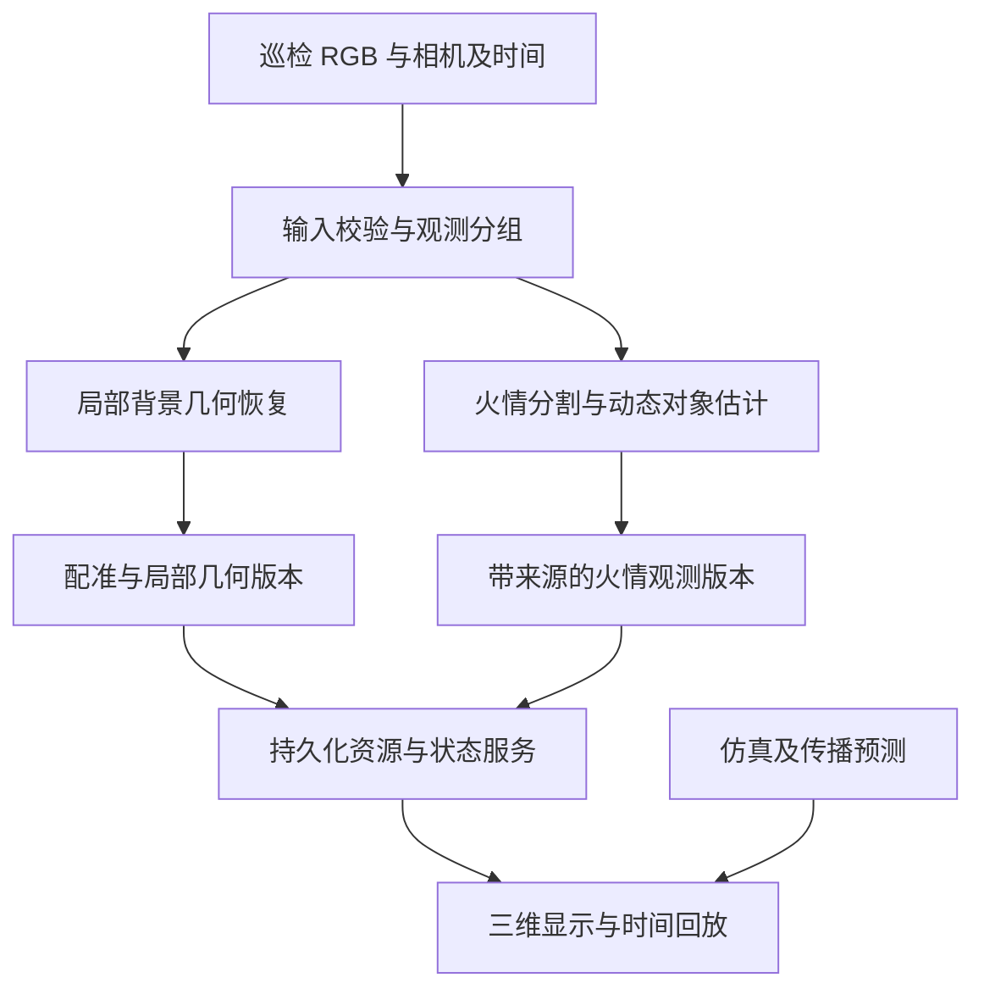

# Fire-X 数字孪生动态建模：需求分析、技术路线与实施安排

版本：2026-10-25，研究与实施建议版。本文基于本会话提供的项目说明、申报资料、旧算法源码、CodeBuddy 实际报告和审核材料，并结合下列一手研究与官方文档。本文中的方案、性能预算和接口扩展均为建议，尚未在用户电脑上实施或实测。

## 1. 本轮结论与目标纠偏

Fire-X 的主线应恢复为：**巡检影像进入系统后，产生可追溯的三维几何或场景状态更新，持续映射到同一个孪生场景，并支持查看与回放。** 火点定位是其中一个功能，不能替代在线场景建模。

重新核对项目书后，可明确区分两个必须推进的任务：

1. **环境的动态建模与完善**：从多视角影像恢复地形、设施等局部结构；进行尺度与坐标对齐；将新点云或网格按版本加入场景。随着巡检覆盖增加，局部模型得到补充，可靠的变化证据也可以触发局部更新。
2. **动态对象与过程的同步显示**：持续更新火情范围、无人机位姿、处置事件；有足够数据时估计火焰的粗三维包络；保留观测时间、来源与质量，支持时间轴回放。

项目书明确写到了“VGGT 深度估计与局部结构恢复”“实时注入点云、相机位姿”“逐步完善底图局部几何”，同时要求火情变化、无人机轨迹及处置过程可视化。因此，后续不能只交付检测框、单个三维点或随时间预设变化的方形。

推荐采取 **固定基础场景＋影像驱动的局部几何更新＋动态状态层**。先完成实际的 RGB→三维局部模型，再将火情变化接入；高保真、逐时刻的三维火焰重建作为有条件的增强项。现有 C1/C2 保留为检测和相机适配基础，暂停原拟继续的单火点 C3。

### 1.1 对“动态”的验收解释

| 层面 | 本项目应展示的真实更新 | 不足以证明该能力的演示 |
| --- | --- | --- |
| 几何建模 | 新影像生成新的局部点云/网格，完成配准后更新场景中的对应区域 | 导入现成 GLB 后仅旋转相机 |
| 模型逐步完善 | 新视角补充可见结构，模型覆盖范围或质量有可核验证据 | 无差别累加点，点数增加但几何漂移 |
| 物理状态变化 | 输入包含变化，估计结果随观测更新；遮挡、缺测有明确状态 | 改时间戳自动放大几何 |
| 动态显示 | 按数据时间更新对象，能停、能回放、能追溯到来源 | 粒子一直播放但状态没有新观测 |
| 预测 | 从明确初始条件和模型计算未来状态，作为预测展示 | 将预测轮廓标作相机已观测事实 |

**首版成功画面**：已有地形和设施底座保持可用；巡检影像生成的一块彩色点云在正确位置出现，后续视角补充该区域；火情范围或具备条件的三维包络按观测变化；无人机位姿同步；停止输入后观测保持，时间轴能回放各次真实结果。

这一定义与 NIST 对模型、数据连接和动态更新的讨论相符；当前使用 Unity 仿真输入时，应称为“仿真驱动的孪生原型”，实地映射能力另行验收。[S01]

## 2. 已有工程的可复用部分和实际缺口

本表是根据已提供的报告与审核材料形成的基线，不等于本轮直接访问了本机仓库。

| 部分 | 已有基础 | 对动态建模仍欠缺的能力 |
| --- | --- | --- |
| 前端基础场景 | Vue/Three.js 地图、详情、三维场景；织金与双江口参考资产 | 图像产生的局部三维点云/网格显示、分块更新、几何版本回放 |
| 前端动态链路 | 已验证 fixture 轮询、绑定校验、覆盖层更新、同视角断开清除 | 真实算法产物与三维数据资源接入；当前火区轮廓是 XZ 数据 |
| 后端 | 运行创建/查询、图像上传/原件保存、串行工作器、结果与快照持久化 | 多图建模任务、观测分组、三维资源发布和几何版本；实际图像提供者 |
| C1 | 本地 YOLO 检测基线可运行，保留正常空结果和失败；有四图真实复跑 | 权重是 detect，不是分割；没有恢复完整火区边界或三维体 |
| C2 | 新 schema 矩阵与换基、尺寸/哈希绑定、像素射线内部核验 | 实际截图相机与 pose 对应、Unity 引擎交叉验证、准确投影参数 |
| 旧 VGGT 代码 | 存在旧推理、点云导出与重建脚本，有旧环境 | 当前模型缓存和可离线加载状态；完整多视图输出；尺度配准与时序融合 |
| 仿真数据 | 存在多 case、不同相机视角及候选灭火序列 | 可信拍摄时间、相机标识；同一时刻多视图；变化的逐帧核验 |
| 地理与模型 | 双江口参考地形、织金资产与坐标资料 | Unity 变电站示例与这些资产之间没有已验证映射，不能直接叠加 |

当前已报告 HEAD 为 C1 检查点 `57831fea4290c77804bd3978450c4e852eb935c7`；C2 尚未提交。B4 检查点为 `4c45e6df00a1ce1dcd25d8b64959d1514facd8d0`。下轮 CodeBuddy 必须核对实际状态，不能假设工作树仍未变化。

### 2.1 对旧代码的具体判断

根据附件源码，旧 `reconstruction.py` 取预测数组的一张 point map 再展开；这不能自动证明已完成多视图融合、连续建图或场景增量更新。旧 `pipeline_run.py` 中已有 YOLO 候选、颜色/帧差与轮廓处理，但后续又压缩为定位像素，未形成可验收的完整区域重建。

因此，已有代码值得复用，但复用方向应调整为 **保留完整深度、置信度、点云和掩膜**。旧加载器还存在本地失败后联网下载的分支；资源核对阶段不能直接调用它来“试试看”。

## 3. 需求拆分与首版范围

### 3.1 首版必须满足

| 编号 | 需求 | 验收产物 |
| --- | --- | --- |
| R01 | 明确建模对象与输入来源 | 一个固定场景、固定样本清单与输入/评估数据边界 |
| R02 | 从 RGB 影像生成局部三维几何 | 非预设的彩色点云，附原图、深度/点图、置信度、相机参数 |
| R03 | 将局部模型放入统一坐标系 | 可复算的尺度与刚体变换、配准误差、独立锚点复核 |
| R04 | 随新影像更新同一局部模型 | 至少两次不同输入形成两个有效几何版本，说明新增/替换区域 |
| R05 | 表达时间变化和未知状态 | 图像时间、计算时间分开；缺测不当作熄灭或结构消失 |
| R06 | 通过现有前后端显示算法产物 | 底座可用、局部层更新、来源明确，不依赖每次重载大模型 |
| R07 | 能停止、回放和追溯 | 停止输入不造新结果；历史版本可查询、可对照原图 |
| R08 | 明确显示火情与无人机状态 | 分开观测、仿真、预测；无人机模型姿态与图像相机相符 |

“首版点云”属于实际三维建模成果，但**不等于**已经恢复完整、封闭、精确的数字资产。网格化、材质和专业模型细节按后续目标提升。

### 3.2 条件满足后推进

| 目标 | 必需的额外条件 | 缺条件时可以诚实交付的内容 |
| --- | --- | --- |
| 地表燃烧范围 | 地面/植被表面几何与可识别的燃烧接触区域，视野/遮挡判断 | 可见火焰掩膜与受约束区域估计，清楚标出假设 |
| 火焰粗三维外包络 | 同时刻多视图、相机标定、可用分割、合适交会角 | 单视角掩膜或待重建状态 |
| 高保真动态火焰 | 同步视频、足够显存与训练环境、针对性方法 | 先用三维粗包络和标注为表现效果的粒子 |
| 地形/设施真实变化 | 对照观测、可见性与配准稳定；变化区域有新证据 | 逐步完善未观测区域，暂不自动删除旧结构 |
| 温度、热释放率、烟浓度 | 热成像/传感器或专门标定、物理模型与验证 | 仅输出图像置信度或明确标注的仿真等级 |

普通 RGB 的亮度、颜色或几何体积不能直接作为测得的摄氏温度、热释放率。申报资料里这些较强的表述，应在实现与展示中补上数据条件。

## 4. 路线比较与推荐选择

### 4.1 环境建模主线

| 路线 | 能得到什么 | 本项目定位 | 主要限制 |
| --- | --- | --- | --- |
| 已有 GLB/DEM 直接显示 | 稳定的三维底座 | 保留并复用 | 本身不证明从巡检图像动态建模 |
| VGGT 多视图深度/点图 | 局部几何、预测相机与置信度 | **第一批 RGB 建模实验的优先基线** | 相对尺度、配准、动态干扰；本地权重状态待核 |
| VGGT-Ω | 更强的深度/相机重建候选，包含动态场景基准 | 独立对照分支，数据与环境就绪后比较 | 新权重/访问条件、版本隔离；火焰效果没有本项目证据 |
| 相机＋可靠深度的点云/TSDF 融合 | 度量点云或表面网格 | 深度有来源且尺度一致后的融合环节 | 从 Unity 直接读取真实深度只能算仿真深度输入路线，不能算 RGB 算法成功 |

**推荐链路**：重叠影像批次 → VGGT 推理 → 完整深度与置信度 → 剔除明显动态/不可靠区域 → 相对模型与已知场景配准 → 局部点云版本 → 场景动态显示。第一版先点云，证明几何成立后再做融合网格。[S02][S03]

原版 VGGT 的论文明确承认对大幅非刚性变形的限制，因此适合优先验证背景设施/地形重建，不能凭它输出了一片火焰附近点云就声称完整火焰重建。[S03]

本轮也查到新版 **VGGT-Ω 已公开代码与模型信息，并包含动态场景研究结果**，因此不能将“VGGT 系列只支持静态”作为笼统结论。它值得对照测试，但公开动态基准不等于已证明对半透明火焰有效。[S04][S05]

### 4.2 火情动态建模与显示

| 路线 | 输出层次 | 可行性判断 | 是否首版主阻塞项 |
| --- | --- | --- | --- |
| 检测框/单点 | 二维候选或空间位置 | 已有基础，但不足以交付动态建模 | 不继续作为主要交付 |
| 掩膜＋表面约束 | 地表/表面上的估计区域，2.5D | 有条件可行，适合作为火情范围第一层 | 否，可与环境建模并行准备 |
| 同时刻多视图掩膜→视觉外壳 | 三维可见目标的粗外包络 | **粗三维动态对象的推荐原型**，需同步输入 | 缺同步数据时暂不实施该分支 |
| Gaussians on Fire | 时间相关的火焰外观与三维表示 | 有公开研究与代码，适合离线增强实验 | 否，避免拖住端到端原型 |
| 粒子/着色器 | 视觉表现 | 可辅助连续显示，参数必须来自状态或明确的仿真 | 否，不作为图像重建证据 |

视觉外壳在烟羽多视图研究中有明确的“分割—体素—表面提取”路线；该论文研究的是**烟羽**，不能直接引用为本项目火焰精度证明。将其用于仿真火焰的粗包络，是需要原型验证的工程推断。[S08]

专门研究火焰的 Gaussians on Fire 采用三台标定相机，将背景与动态火焰分开处理，并已发布代码。论文的训练与渲染是不同阶段：作者设备上单场景训练约 30 分钟，渲染单图约 7.4ms；这些数值不能理解成新输入火焰可在线即时重建。[S09][S10]

## 5. 推荐架构



这里的仿真/预测分支应在界面和数据上标明来源，不能覆盖已观测事实。评估用真值不进入上述 RGB 估计链路。

### 5.1 每层负责什么

- **输入层**：原图、相机实际投影、位姿、标识、拍摄时间或同仿真步观测分组。背景可以用短窗口多视图；快速变化的火焰体必须使用同时刻或经验证可接受时间差的视图。
- **模型层**：背景几何与动态对象分开估计。建模可以是批次更新，无须与浏览器渲染帧率相同。
- **坐标层**：先在 Unity 示例的独立局部右手坐标中成立；有真实对应锚点后再接双江口/织金，不为了“看到叠加”随意平移缩放。
- **服务层**：大几何保存在不可变资源文件中，状态消息只携带资源引用、版本、时间、范围和质量。
- **显示层**：基础模型保持；局部层按版本替换或更新缓冲；提供来源、时间、质量与过期提示；回放时按数据时间选择版本。

## 6. 环境几何的可实施链路

### 6.1 固定小范围实验，先证明“图像变成模型”

从同一场景挑选一组有视差、背景重叠的影像。第一批建议 4–8 张作为待测起点，最终数量取决于实际数据、显存和质量；不能把这个范围当作算法保证。先固定数据清单、图像/pose 哈希、参数及输出目录，再运行。

第一份建模结果保留：输入列表、原始推理输出摘要、深度/置信度预览、完整有效点云、每个视图的相机参数、运行日志与资源消耗。**不得只取一个像素、一个检测框或一张点图作为整个多视图建模成果。**

背景几何先排除明显火焰、烟、天空、强反射和低置信度点；这些被排除区域保留“未可靠恢复”的含义，不补假表面。

### 6.2 将相对模型配准到场景

VGGT 产生的局部结果不能未经验证就当作米制地理坐标。工程上拟采用相似变换：

`p_scene = s · R · p_reconstruction + t`

其中 `s` 为尺度、`R` 为旋转、`t` 为平移。可利用已知相机位姿和/或背景控制点建立对应；有足够空间分布、非退化的对应后拟合，并用未参与拟合的锚点验证。只有两台相机的中心并不足以一般性地消除全部旋转歧义；轨迹近共线时也要检查退化。

对于背景点云，初始对应成立后可尝试 ICP 等方法细化，但不能让局部配准把错误的模型“硬贴”到场景。Open3D 提供全局与局部配准、深度融合等官方流程；库具备这些工具不代表数据已满足尺度、重叠与噪声条件。[S06][S07]

### 6.3 从单批模型到增量模型

第二批影像与第一批保留重叠锚点，以统一坐标和局部区域 ID 对齐，记录新增覆盖和误差。首版可以按小块替换高质量点云，不要求马上实现复杂 SLAM。

更新必须区分：

1. **覆盖增加**：此前看不到的侧面被恢复；这是模型完善。
2. **重建噪声**：相同表面随视角产生抖动；不是物理变化。
3. **可靠场景变化**：有新观测支持某物体移动、结构出现或消失；才允许更新相应结构状态。

不能因为某批影像缺少旧表面就删除该表面。持续融合静态表面时，可信深度和相机参数满足条件后，再考虑 TSDF；跨时间累积火焰或移动物体会拖影，不能与静态背景一起无差别融合。[S07]

### 6.4 逐步网格化

先以彩色点云验收几何；再根据用途选择体素融合、表面提取或保留点云。薄导线、遮挡边缘和透明/反射物体应单独标质量。把预测深度融合为漂亮网格，不能自动提高其真实精度。

## 7. 动态火情的可实施链路

### 7.1 先保留区域，再决定空间表达

现有检测器输出 bbox，只能提供候选区域。要得到形状，需要图像掩膜。可分两步推进：

1. 在固定仿真场景中，复用现有 YOLO 候选与旧颜色/差分方法形成简单基线，保留全部区域和失败。相机移动时不能将普通帧差直接当火情变化；不得在分割失败时静默用整幅差分区域兜底。
2. 若基线质量不足，再对照测试 YOLO 框提示的 SAM 2/2.1。SAM 是提示式分割工具，不自带“识别火焰且边界正确”的保证，需人工标注小集核验。[S11]

当前旧环境 torch 2.3.1；SAM 2 官方当前安装要求更高的 torch/torchvision 版本。因此若采用该路线，应另建实验环境，不升级已经可运行的旧环境或后端环境。下载与安装放到明确的实施任务中，本轮仅研究。[S11]

### 7.2 地表范围：可用，但必须说清假设

对确实位于已知地面或植被表面的燃烧接触区域，可以用相机射线与表面相交恢复 2.5D 区域。此时仍需：遮挡判断、有效射线、足够采样，以及边界到底代表“可见火焰”“燃烧接触区域”还是“已烧区域”的定义。

**将所有空中火焰像素投到地面，或把三维包络压平，都不等于真实燃烧足迹。** 火焰高度、烟遮挡、斜视角会影响投影；缺少接触区域证据时应输出估计和适用条件。

### 7.3 粗三维包络：同步多视图路线

拟采用同一观测组内的相机标定与估计掩膜：

`同时刻 RGB → 每视图火焰掩膜 → 有限局部体素域 → 多视图投影约束 → 可见目标粗外包络 → 点云或网格`

建议仿真首个实验使用 3 台有良好交会角的虚拟相机，并另设 1 台仅作留出评估。这个配置是实验设计，不是三台一定足够的数学承诺；也不意味着必须购买额外硬件。

第一版从 `32³` 或 `64³` 的小 ROI 体素开始做可测原型，再按误差和开销调整。范围和体素尺寸必须记录，不应把整个区域统一体素化。

关键约束：

- 单台移动相机的不同时刻帧，不能直接拼成变化火焰的同一时刻多视图。
- 目标在某视图中被遮挡时，该视图不能简单把对应体素判成空；“未知”与“背景”要分开。
- 目标超出视野或被画面裁切，需要标不完整，不强行给封闭完整体。
- 透明、发光、烟火混合和掩膜误差会影响视觉外壳。输出定位为**依赖阈值的可见形态粗包络**，不称为测得的物理密度或真实燃烧体积。
- 不能将二维 bbox 的视锥交集称为精确火形；不能生成预设球/柱/盒子，再声称图像重建。

该分支的算法路线来自相关多视图研究，针对本项目数据的可行性与质量必须实测。[S08][S09]

### 7.4 时间序列如何成立

至少固定数个观测时刻，每个时刻有同步视图；分别估计，再以观测时间组成序列。先做“逐时刻独立估计”，确认几何来自图像，再研究时序平滑与跟踪。

缺帧、烟遮挡或检测失败应记录为未获得有效观测；不能自动判火熄灭。没有新观测时保持最近有效状态并显示其时效。state_machine 的 miss/return 更适合检验可见性和恢复，不自动代表火势缩小或重燃。

### 7.5 高保真增强项

Gaussians on Fire 适合在端到端原型之后，用独立数据和环境比较外观重建。应分别报告预处理、训练、渲染与发布延迟。其公开实现涉及 CUDA、其他模型及研究代码依赖，不能只依据“有 WebGL 演示”就承诺直接嵌入现有 Three.js。[S09][S10]

## 8. 采集与数据协议：当前最重要的缺口

### 8.1 输入应具备的字段

| 类别 | 最少内容 | 用途 |
| --- | --- | --- |
| 来源与绑定 | 数据集/场景/资产/坐标系、图像哈希 | 防止不同场景或版本混用 |
| 相机 | camera_id，真实渲染相机标识 | 多相机区分、截图与位姿绑定 |
| 投影 | 实际尺寸、内参或完整投影、视口/裁切、透视类型 | 避免只用 FOV 推导却忽略像素矩形或缩放 |
| 位姿 | 明确方向和手性的 camera_to_world、单位 | 将像素/深度转换到统一空间 |
| 时间 | simulation_time_s 或带时区的 captured_at | 表达观测时间；不得用文件 mtime 或帧编号伪造秒数 |
| 同步组 | observation_group_id、组内时差、预期视图数 | 多视图动态对象重建与缺视图处理 |
| 标定信息 | 来源、方法、适用范围和验证状态 | 区分已验证输入与仅有假设的输入 |

现有 capture metadata 的 schema 1.0 对额外字段严格校验，尚无上述 camera_id/观测组等扩展。**不能直接往现接口塞新字段并假定后端接受。** 实验可先用旁路清单组织；进入服务前再设计兼容 schema。

### 8.2 Unity 输入端最小改进方向

实际 `TakePhoto.cs` 用整屏截图、另取 Inspector 指定的 targetCamera 位姿。C2 证明了矩阵内部一致性，未证明这个相机就是实际截图视图。

采集改造的目标应是：在同一仿真状态下，从明确的各台相机获得对应 RGB、实际投影与位姿，再记录同一个时间与观测组。不能重复执行整屏截图、同时更换 pose，就称为多相机同步采集。

项目书写有 Unity 2022.3.62f1c1，但实际可运行工程及渲染管线尚未核实。采集实现要先确认内置管线/URP 等，选择该版本支持的 RenderTexture/渲染路径；不能未经核对直接套 Camera.Render 到所有管线。[S16]

### 8.3 估计输入与评估真值的边界

- 估计器输入：RGB、相机标定、时间、事先公开的基础场景约束。
- 评估通道：独立的掩膜、已知物体/火场参数、深度、网格或其他真值；不能读入后再输出为“恢复结果”。
- 若使用 Unity 直接导出的深度/状态驱动显示，应另标为“仿真数据映射链路”。它有工程价值，但不能替代 RGB 建模实验。
- 透明粒子不一定按预期写入普通深度缓冲；不能把默认深度图直接称为火焰深度真值。具体渲染方式需要核实。

## 9. 前后端怎样承载真正的三维动态结果

### 9.1 兼容扩展，而不是改坏 B4

已有 FirePatch 是闭合的 XZ 轮廓，适合继续承担地表/投影区域显示；它不能表达一般三维点云、网格或体素。建议新增独立的三维资源描述，具体协议待原型产物确定后设计。

建议考虑的内容：

| 内容 | 示例含义，均为提案 |
| --- | --- |
| representation | point_cloud / triangle_mesh / voxel_envelope |
| resource | 资源引用、SHA256、大小、格式、坐标边界 |
| version | 局部区域 ID、几何版本、父版本或被替换区域 |
| binding | scene_id、asset_version、coordinate_frame_id |
| time | 观测时刻或时间窗、计算产生时间 |
| evidence | 输入 capture IDs、观测组、提供者版本 |
| quality | 有效视图数、配准残差、覆盖范围、裁切/遮挡/失败原因 |
| provenance | 图像估计、仿真、fixture 或预测，语义明确且可查询 |

这张表不是已实现的 JSON schema，也不代表上述字段名已获接口支持。本轮不新增对外接口或承诺上线地址。

现有六个接口保留：health、创建运行、查询运行、上传 capture、查询 capture、查询 state。后续需要的几何资源读取与历史查询，要在明确产物、大小和回放需求后形成单独契约并测试。

### 9.2 渲染方式

首版优先 Three.js Points/BufferGeometry 显示彩色点云；粗体素可选实例化显示，网格成熟后再接网格资源。官方支持以缓冲表达点/线/面，也有缓冲更新与实例化机制，因此当前技术栈具备可用显示基础；实际性能仍需在既有版本和设备上测试。[S12][S13]

基本原则：基础 GLB 只在场景切换或必要时加载；局部重建层单独管理。新版本资源校验成功后再替换可见对象，失败保留最近有效层并显示原因。相机取景变化不修改模型几何。

### 9.3 更新率与观测时间

三种频率分开衡量：采集/上传、几何计算、浏览器渲染。第一版可设“几何每 0.5–2 秒尝试更新、浏览器约 25fps 连续显示”为待测预算；如果模型无法达到，则如实显示批次更新或离线回放，不能伪造实时性。

原项目材料提出过三维在线更新延迟 ≤30 秒，建议先将其作为**待验证端到端目标**，从接收最后一张必要输入到页面可见记录 P50/P95，以及采集时间到可见时间。尚无实际性能数据前不宣布达标。

浏览器插值和粒子动画只服务观看，不创建观测、不推进 revision，也不证明物理变化。

## 10. 传播预测与处置仿真放在哪里

ForeFire 等传播模型可以承担给定地形、燃料、气象和初始火线后的仿真预测。公开实现提供相应仿真和地理数据输出能力，但它不是从 RGB 恢复当前真实火场的算法。[S14]

本项目可形成三种同屏、可切换来源：

1. **观测估计层**：由图像/传感器产生，带时间与质量。
2. **仿真过程层**：Unity 或传播模型生成，带仿真时钟和参数。
3. **未来预测层**：从明确初始状态推算，标注预测起点、时效和假设。

实际灭火动作、投放与抑制结果的同步属于后续过程联动。图像未检出不作为唯一灭火成功条件；若展示温度/强度，说明其传感器或仿真来源。

## 11. 验收设计：先检验能力，再扩展系统

### 11.1 环境建模验收

| 实验 | 必须保存的证据 | 防止的误判 |
| --- | --- | --- |
| 固定 RGB 小集建模 | 输入哈希、推理参数、深度/置信度、点云、相机、运行日志 | 将现成模型导入当作重建 |
| 坐标配准 | 拟合对应、独立验证点、尺度、误差与变换 | 仅手工平移到看起来合适的位置 |
| 第二批视角更新 | 前后点云、重叠区域误差、新覆盖区域 | 点数增加即质量提高 |
| 动态干扰控制 | 有/无火烟输入、排除区域、静态结构差异 | 将烟火和视角噪声融合成永久设施 |
| 变化识别 | 有明确物体变化的输入与对照，或如实标仅完善模型 | 把观察角度变化当作环境变形 |

若没有度量几何真值，先报告重投影、配准稳定性与覆盖，不宣称厘米级/米级精度。使用 Unity 真值时留出独立评估，不将其导入点云估计流程。

### 11.2 动态火情验收

- 先固定含火、烟/高亮干扰、遮挡、视野外等样本；真值未核实的标 uncertain。
- 掩膜有人工核对或小集标注；零检测、分割失败、未知可见性分开记录。
- 多视图测试先用已知几何/理想掩膜验证数学模块，明确标为合成单测；然后用 RGB 估计掩膜运行，后者才算图像链路证据。
- 对粗三维包络，保存每台相机的重投影对照；优先用未参与恢复的留出相机评估。没有三维真值时，不报真实体积精度。
- 同一时刻不同视角与不同时刻同一对象分别测试；前者测试空间一致性，后者测试动态变化。
- 停止输入后结果稳定；遮挡/缺视图不误判熄灭；恢复可见后能重新获得有效观测。

### 11.3 系统显示验收

页面展示实际点云/网格顶点更新，固定相机对比；断开时清理动态层并保留底座；轮询不重载基础模型。测试错场景、错坐标系、旧版本、过期观测、算法失败、资源损坏、迟到响应；所有失败都不能变成静默的 fixture 成功。

保留已有 52 项后端回归及前端构建/数据/浏览器流程。新切片先运行相关检查，业务契约或显示代码改变后再运行适当全量回归。

## 12. 分阶段实施计划与决策门槛

### D0：本机准备度核对——下一轮只做这一项

核对真实仓库状态、旧 VGGT 本地资源、候选背景多视图、候选变化序列，以及实际 Unity 工程/采集端是否可得。只生成一份可评审清单与小包；不改业务源码，不开始单火点三角化，不运行下载式加载器。

**通过条件**：能明确选定环境建模样本组；知道本地模型能否离线加载；能列出相机绑定和尺度验证缺口。动态火焰分支额外回答是否存在同时刻多视图，缺失时给最小采集任务。

### D1：RGB→局部三维模型基线

固定样本，优先使用已有 VGGT 资源。运行完整多视图几何恢复，保留点云/深度/质量与全部中间依据。先独立实验，不立即接 worker 或生产前端。

**通过条件**：真实输入产生结构可辨、非退化的局部点云；没有以现成场景几何填充结果；失败能明确报告。没有缓存时先形成最小下载/环境方案，不能默默联网回退。

### D2：配准与连续两批局部更新

同场景第二批视角补充模型，验证尺度与配准、重叠稳定性，生成两个可回放几何版本。先独立局部 demo，之后再确认地理场景锚点。

**通过条件**：可复算坐标、可量化的重叠误差与新增覆盖；模型变化有输入证据，不只是切换文件名或时间戳。

### D3：动态火情模型原型

与 D1/D2 并行准备掩膜和有时间的候选序列。对可用的表面约束先做范围估计；若同步多视图具备，则做逐观测的粗三维包络。缺数据时安排小规模 Unity 同步采集，不重复单点工作来填补交付。

**通过条件**：至少多个有效时刻的图像估计；边界或几何实际变化、来源可追溯；与可见性变化和仿真真值明确区分。

### D4：契约、后台与三维显示接入

原型产物确定后，再设计多图任务/几何资源/历史版本协议；保留现有接口兼容性。接工作器、持久化与前端局部层，完成真实算法到页面和时间轴的回归。

**通过条件**：从上传到模型可见有完整证据，重启持久化成立，错绑定拒绝，停止输入保持，不破坏原场景。

### D5：正式场景与过程联动

完成双江口/织金相机与模型配准；添加无人机姿态、处置事件与独立预测层。高保真火焰、长期性能、多机与实地试验按材料和设备条件逐步扩展。

不承诺固定日程：D0 会决定本地模型和输入是否就绪，D1 实测决定算力与更新速度。阶段内尽量一次只引入一种新算法或一种契约变更，便于验收。

## 13. 组织方式与近期交付

| 工作 | 本轮/后续负责人安排 | 具体产物 |
| --- | --- | --- |
| 需求与路线 | 由我统筹，依据报告持续修订 | 本文、阶段目标、算法比较、验收标准 |
| 本地证据与实现 | 用户通过 CodeBuddy 执行，我写提示词并审查 | 实际文件、命令退出码、输出、差异与审核包 |
| Unity 输入与采集 | 由持有可运行 Unity 工程的成员提供；先核实持有人 | 绑定相机的 RGB/pose/time，以及必要的同步多视图 |
| 场景与配准 | 由有场景文件/测绘资料的成员配合 | 场景版本、坐标定义、锚点和独立验证点 |
| 接口联调 | 算法原型成立后安排 | 兼容契约、真实资源、测试运行、联调记录 |

近期最有价值的三个结果是：**一份可运行的背景几何小样本实验、一份有时间依据的动态输入清单、一份显示真实三维版本的页面证据**。无需先重写已经工作的后端或新建大型框架。

## 14. 研究依据与阅读顺序

以下均为作者论文、官方项目/仓库或官方文档；核对日期为 2026-10-25。公开能力与作者设备性能是研究依据，本机可行性仍需实验。网络仓库会更新，实施时记录 commit、模型哈希及实际依赖。

### 建议先读

1. **原版 VGGT 官方示例与论文局限**：确认完整几何输出、坐标尺度与非刚性限制。[S02][S03]
2. **VGGT-Ω 项目与模型说明**：了解新版已支持的动态基准；是否采用等本地资源和对照结果。[S04][S05]
3. **Open3D 配准/融合文档**：理解从相对点云到同场景增量模型的工程步骤。[S06][S07]
4. **多视图烟羽研究**：了解掩膜到粗体积的过程与少视角伪影，注意对象是烟羽。[S08]
5. **Gaussians on Fire 最新论文**：了解真正动态火焰重建的输入、方法及训练成本。[S09][S10]

### 来源清单

- **[S01]** NIST，Digital Twins: Essential Elements。https://www.nist.gov/digital-twins/essential-elements
- **[S02]** Meta，VGGT 官方实现与推理示例。https://github.com/facebookresearch/vggt
- **[S03]** Wang 等，VGGT: Visual Geometry Grounded Transformer，CVPR 2025。https://arxiv.org/html/2503.11651
- **[S04]** VGGT-Ω 官方项目与实现，2026。https://vggt-omega.github.io/ ；https://github.com/facebookresearch/vggt-omega
- **[S05]** Meta，VGGT-Ω 模型与访问/许可说明。https://huggingface.co/facebook/VGGT-Omega 。模型访问及研究用途条款需在采用前核对；不自动替换现有模型。
- **[S06]** Open3D 0.19，Global registration。https://www.open3d.org/docs/release/tutorial/pipelines/global_registration.html
- **[S07]** Open3D 0.19，RGBD integration。https://www.open3d.org/docs/release/tutorial/pipelines/rgbd_integration.html
- **[S08]** Blanco 等，Estimation of 3D Shape and Volume of Fire Plumes from Multiple Views，2024。https://doi.org/10.1088/1742-6596/2885/1/012075 ；作者论文托管：https://research.fs.usda.gov/download/treesearch/68882.pdf
- **[S09]** Nazarenus 等，Gaussians on Fire: High-Frequency Reconstruction of Flames，最新核对为 2026-07-02 v2。https://arxiv.org/html/2511.22459v2 ；项目：https://jna-358.github.io/gaussians_on_fire/
- **[S10]** Gaussians on Fire 官方实现与依赖说明。https://github.com/jna-358/gaussians_on_fire
- **[S11]** Meta，SAM 2/2.1 官方实现、提示式分割示例与依赖。https://github.com/facebookresearch/sam2
- **[S12]** Three.js，BufferGeometry。https://threejs.org/docs/pages/BufferGeometry.html
- **[S13]** Three.js，How to update things；InstancedMesh。https://threejs.org/manual/pages/how-to-update-things.html ；https://threejs.org/docs/pages/InstancedMesh.html
- **[S14]** ForeFire 官方实现。https://github.com/forefireAPI/forefire
- **[S15]** Pesonen 等，Detecting Wildfires on UAVs with Real-Time Segmentation Trained by Larger Models，WACV 2025。https://arxiv.org/abs/2408.10843 。该文主要研究烟雾分割，作为分割路线参考，不作为火焰三维精度依据。
- **[S16]** Unity 2022.3，Camera.Render。https://docs.unity3d.com/2022.3/Documentation/ScriptReference/Camera.Render.html 。实际采集实现还须核对项目渲染管线和版本。

本地材料依据：Fire-X 项目说明、大创申报资料、已提供的旧 pipeline 源码、C0/C1/C2 与 B1–B4 报告及审核材料。项目书中的硬件和技术指标是规划描述，不能替代当前机器检测与实测。

## 附录 A：下一条 CodeBuddy 提示词（只做 D0，不实施 C3）

下面整段可直接粘贴。技能按 `/技能名` 调用；缺少技能时如实记录，不虚构已调用。

```text
/source-driven-development
/git-workflow-and-versioning

本轮任务：Fire-X 数字孪生动态建模 D0 准备度核对。暂停此前拟议的单火点 C3，不做三角化定位。本轮以只读检查为主，只新增一份清单文档和忽略目录内的小审核包。

目标：为“巡检 RGB→局部三维几何→统一场景增量更新”和“火情范围/具备条件的粗三维动态对象”选择真实可运行的输入与资源。检测框、单点、预设几何和已有模型导入都不能替代图像建模成果。

一、核实实际状态
1. 在 /home/dailen/projects/firex-platform 核对仓库、分支、HEAD 和工作树。预期分支 feat/frontend-backend-layout，最近报告 HEAD=57831fea4290c77804bd3978450c4e852eb935c7；C2 experiments/c2-camera-geometry/ 尚未提交。如果实际不同，记录差异、保留全部已有工作，不回退、不覆盖。
2. 读取现有 AGENTS.md、相关实验 README 和 docs/image-estimation-readiness.md；只报告与本任务有关的约束。不要提交、推送、合并或部署，不修改 .codebuddy，不触碰其他项目服务。

二、核对环境建模资源与样本
3. 仅在此前已明确的 /home/dailen/vggt/my_project/pipeline/、/home/dailen/vggt/vggt-env/ 以及源码实际指向的有限缓存位置，核对旧 VGGT 加载器、推理与重建脚本。记录模型类/版本、缓存是否存在、文件大小/哈希与实际加载路径。识别联网 fallback，但不要调用 load_model、推理或会触发下载的 from_pretrained。不要扫描主目录/全盘。
4. 只读记录当前机器 GPU 型号/显存和已有环境版本；项目书所写 RTX4080 不作为本机检测结果。没有已安装的 SAM/VGGT-Ω 就记未找到，不安装、不下载、不升级依赖。
5. 在 /home/dailen/Nutstore Files/Fire_X/demo_sequences/ 的已知 case 和 state_machine_case 中，选择一组背景重叠、具有视差的 RGB 候选，目标 4–8 张、优先完整矩阵新 schema；不足则如实列出。记录图像与 pose 的实际路径/哈希、尺寸、source_stem、位姿差异、是否同场景、时间字段和重叠判断依据。不用旧欧拉角顺序猜位姿，不把不同 source 自动当作同步视图。只提出建模样本清单，本轮不运行模型。

三、核对动态输入与采集条件
6. 定点检查 case04_extinguish 的 notes、目录和 pose schema；若共 21 帧，先固定第1/6/11/16/21张，其他数量则固定首、约四分之一、中间、约四分之三、末帧并记录规则，不按检测结果换样本。实际打开这些图像检查火焰可见性、遮挡、相机变化；若工具不能看图，标“未目视”，不宣称有物理变化真值。帧号/mtime 不作为真实拍摄时间。
7. 核对现有资料是否有同一时刻多相机 RGB+pose+camera_id+观测组+仿真时间。没有就明确写“动态火焰同步多视图缺失”，不要把相机移动的连续帧拼成瞬时体积。
8. 读取已知 TakePhoto.cs 与 C2 UnityCameraProbe.cs，列出截图相机绑定、投影/视口、时间、同一步多相机导出缺口。仅按已知明确路径核对是否有可运行 Unity 工程；未提供路径或不存在就记“需持有工程的队友提供”，不扩展搜索磁盘。若存在，记录 Unity 版本与渲染管线，不启动/修改工程。

四、交付
9. 只新增 docs/dynamic-twin-readiness.md（保持未提交）：实际仓库状态；资源表；环境建模固定样本组；动态候选帧清单；采集缺口；哪些能立即做 D1 RGB几何实验、哪些需补数据。将“已核实/推断/未核实”分开。优先给出最小下一步，不扩建后端或前端。
10. 在 runtime-data/review/firex_dynamic_readiness.zip 生成小审核包，包含文档、样本索引/哈希、必要加载与重建脚本，以及选定候选原图+pose（控制数量；若体积大则先选关键帧并完整列清单）。保留来源，不包含权重、虚拟环境、缓存、数据库、凭据或大型模型；原件只复制不修改。
11. 报告实际命令/结果、检查范围、剩余缺口、git status 与 git diff --check。没有改业务代码时不重复全套测试，不伪造推理/引擎验证。所有进程和服务保持原状。

本轮最终回答必须明确：
A. 下一轮能否立即从现有 RGB 运行一次完整局部三维建模？缺什么？
B. 是否具备同时刻多视图的动态三维火焰输入？缺什么？
C. 怎样以最小采集/实验切片补齐，使下一轮进入建模而非继续只做找火点？
```
